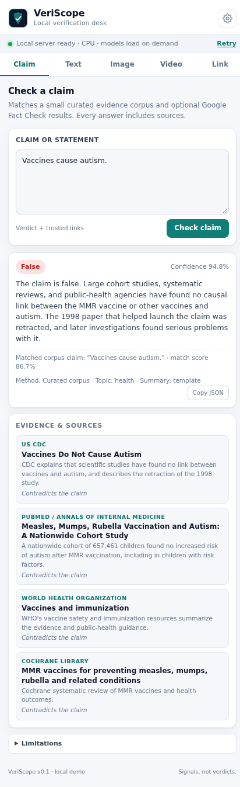

# TAYO

**A local-first verification desk for journalists.** A Manifest V3 browser
extension backed by a local FastAPI server: check claims against trusted
sources, triage AI-generated text and media, read provenance metadata, and
inspect suspicious links without opening them.

> Every output is a **triage signal, not proof**. TAYO is a demonstration
> built for local use, not a forensic product or an automated editor.



More screenshots: [text detection](docs/screenshots/text-check.png) ·
[image analysis](docs/screenshots/image-check.png) ·
[passive URL scan](docs/screenshots/url-scan.png).

---

## What it does

| Tool | What you get |
|---|---|
| **Claim check** | English and Mongolian Cyrillic / informal Latin galig matched to a small sourced corpus; `True` / `False` / `Not Sure` with evidence links. |
| **AI text check** | English ModernBERT classifier + style statistics. Mongolian text gets script recognition and Unicode-aware statistics, without an unvalidated AI score. |
| **AI image check** | Smaug classifier (Nano Banana/Imagen-era coverage), EXIF/XMP inspection, generator-name hints, C2PA/JUMBF presence, and SHA-256. |
| **Video check** | Right-click a video or supply a direct URL for ffmpeg frame sampling. Blob/stream players get a clearly marked check of the visible frame only. |
| **Suspicious link** | Passive DNS/DNSSEC, TLS certificate, RDAP domain age, typosquatting heuristics, and optional threat intel. **The page body is never fetched.** |

The extension is a thin UI. Heavy models, ffmpeg, DNS/TLS/RDAP lookups, and the
optional local LLM live in the backend, bound to `127.0.0.1` by default.

### Mongolian input

The **Claim** tab accepts both `Дэлхий хавтгай.` and `Delhii havtgai`, or
`Вакцин аутизм үүсгэдэг.` and `Vaksin autizm uusgedeg`. These are matched
against the same curated claims. A negated variant such as `үүсгэдэггүй` does
not inherit the opposite verdict. Unmatched claims return **Not Sure** with
search links. Informal galig has many spellings, so some variants will not
match; this is not general translation or fact-checking of arbitrary claims.

The **Text** tab recognizes Mongolian Cyrillic and common informal Latin galig,
counts its words, and shows style statistics. The bundled AI-text model was
trained for English; no Mongolian AI-authorship percentage is displayed.
Both text forms have an **Input language** selector. Leave it on Auto for
ordinary input, or choose Монгол латин галиг when an unusual spelling is not
recognized automatically.
Image, video, and URL checks are language-independent.

---

## Is a local server needed?

**Yes, for this demo.** A browser extension cannot practically run the full
stack:

- The image detector is ~870 MB and the text model ~299 MB; loading them into a
  short-lived MV3 service worker is not reliable. Service workers are evicted
  when idle and cannot keep a multi-gigabyte PyTorch process warm.
- Video analysis needs ffmpeg.
- Passive URL analysis needs raw DNS, TLS handshakes, RDAP, and optional
  threat-intel API calls.
- A local Ollama model (2–4 GB) cannot run inside the extension.
- Shipping remote code or downloading executable model code at runtime is
  restricted by Chrome Web Store policy.

A **pure extension** is possible only for a much smaller scope: for example, a
quantized 10–50 MB ONNX image classifier running in WASM/WebGPU, plus a hosted
fact-check API. That would be a different product with lower accuracy and much
less capability. Other alternatives are a native-messaging host (harder to
install) or a hosted backend (privacy/cost trade-offs).

This project deliberately keeps the server local so the demo works offline
after the first model download, with no accounts or cloud inference costs.

---

## Architecture

```
┌──────────────────────────┐        HTTP (localhost)        ┌─────────────────────────────┐
│ Chrome / Edge side panel │  ───────────────────────────▶  │ FastAPI backend             │
│                          │                                │                             │
│ • Tabs & forms           │  ◀───────────────────────────  │ • Fact-check corpus + APIs  │
│ • Context menus          │          JSON results          │ • Image / text / video      │
│ • JSON copy              │                                │ • Passive URL scanner       │
│ • No ML, no page scripts │                                │ • Optional Ollama summaries │
└──────────────────────────┘                                └──────────────┬──────────────┘
                                                                           │
                                     ┌─────────────────────────────────────┼──────────────────────┐
                                     ▼                                     ▼                      ▼
                              Transformers models                  ffmpeg frames          DNS / TLS / RDAP /
                              (Smaug + ModernBERT)                 (image model)          optional threat intel
```

- **Extension:** `extension/` — Manifest V3, vanilla HTML/CSS/JS, side panel,
  context menus. No build step, no third-party scripts, no remote code.
- **Backend:** `backend/app/` — FastAPI, lazy model loading, upload limits,
  SSRF protection, temp-file cleanup.
- **Fact-check data:** `backend/app/data/factchecks.json` — small curated demo
  corpus with trusted links.
- **Benchmark:** `benchmark/` — reproducible 10-image smoke test, 300-image
  Google-focused evaluation, 150-image recompression check, and results.
- **Docs:** `docs/` — setup, architecture/security, models/training.

More detail: [`docs/ARCHITECTURE.md`](docs/ARCHITECTURE.md).

---

## Quick start

### Requirements

- Linux, macOS, or Windows with WSL2 (tested on WSL2)
- Python **3.12** and [`uv`](https://docs.astral.sh/uv/)
- Chrome, Edge, Brave, or another Chromium browser **116+**
- ~4 GB free disk for the virtualenv, models, and samples
- 8 GB RAM minimum; 16 GB recommended when the browser and backend run together
  (the demo runs on CPU; CUDA is optional)
- `ffmpeg` is **not** required system-wide — `imageio-ffmpeg` provides a binary

### 1. Set up and start the backend

```bash
# from the repository root
./scripts/setup_backend.sh

# pre-download the exact pinned model revisions (~1.2 GB)
.venv/bin/python scripts/warmup_models.py

# start the API (keep this terminal open)
./scripts/run_backend.sh
```

`setup_backend.sh` recreates `.venv/` and copies `backend/.env.example` to
`backend/.env` when it is missing. `warmup_models.py` downloads the exact Smaug
and ModernBERT revisions pinned in `.env.example` into `backend/.model_cache/`.
Those three paths are intentionally **not** committed: a fresh clone rebuilds the
environment and re-downloads the same weights with the two commands above.

Open <http://127.0.0.1:8000/docs> to confirm the API is running, or:

```bash
curl http://127.0.0.1:8000/api/health
```

The first image/text request downloads weights if you skipped the warmup and is
slow. Later requests use the local cache in `backend/.model_cache/`.

### 2. Load the extension

1. Open `chrome://extensions` (or `edge://extensions`).
2. Turn on **Developer mode**.
3. Click **Load unpacked** and select the `extension/` folder.
4. Pin **TAYO — Fact Check & AI Triage** to the toolbar.
5. Click the icon. The side panel opens.
6. Keep the backend terminal running.

The status bar at the top of the panel shows whether the local server is
reachable. If it is offline, start `./scripts/run_backend.sh` and press
**Retry**.

> After editing extension files, press the **reload** icon on the extension
> card. After editing backend files, restart `run_backend.sh` (or run uvicorn
> with `--reload` for development).

### 3. Try it

| Try | Where |
|---|---|
| `Vaccines cause autism.` | **Claim** tab → expect **False** with a WHO link. |
| `Дэлхий хавтгай.` / `Delhii havtgai` | **Claim** tab → both return **False** with a NASA link. |
| A Mongolian Cyrillic or galig paragraph | **Text** tab → script and style statistics, with no AI-authorship score. |
| `The moon is made of a very specific type of cheese.` | **Claim** tab → expect **Not Sure** plus trusted search links. |
| Any long AI-sounding paragraph | **Text** tab → classifier score and style stats. |
| `benchmark/data/ai/ai_03_sdxl_astronaut.png` | **Image** tab → upload; metadata + classifier. |
| `https://example.com` | **Link** tab → low-risk passive report. |
| `benchmark/data/sample.mp4` (created by the smoke test) | **Video** tab → frame sampling. |

Right-click shortcuts also work:

- Select text on a page → **Fact-check selected text**
- Select text on a page → **Analyze selected text for AI generation**
- Right-click the page → **Analyze page text with TAYO**
- Right-click a link → **Scan link for phishing risk**
- Right-click an image → **Analyze image for AI generation**
- Right-click a video → **Inspect video with TAYO**
- Right-click the page → **Inspect visible video with TAYO** (for players with an overlay)

The selected content is placed in the side panel and the relevant analysis
starts automatically.

The image shortcut uses the original public image URL when available. For a
`blob:` image or a URL the backend cannot download, it inspects a screenshot of
the displayed image when the image is visible in the main page frame. The
result marks that original metadata and resolution are lost.
The page-text shortcut reads the largest article, then `<main>`, then the page
body, capped at 100,000 characters. Text analysis of Mongolian Cyrillic and
Latin galig remains statistics-only until a validated model is added.

For a public `http(s)` video file, the backend downloads up to 100 MB and
samples multiple frames. A `blob:` or Media Source player has no standalone
file URL, so the extension captures the visible player and analyzes one frame.
If a direct URL requires browser credentials and the download fails, it falls
back to that captured frame.

That frame result does **not** describe the entire video. Authenticated video
URLs, HLS/DASH playlists, DRM, and players inside restricted frames may need
the original file for full-video analysis.

---

## How the extension is built

There is no bundler and no framework. The whole extension is five files plus
icons:

```text
extension/
├── manifest.json    # MV3 declaration, permissions, side panel, icons
├── background.js    # service worker: context menus + video frame capture
├── panel.html       # side-panel markup: Claim / Text / Image / Video / Link
├── panel.css        # design system, light/dark, responsive
├── panel.js         # API client, form handling, safe DOM rendering
└── icons/           # generated PNGs
```

Key points:

- **`side_panel`** in `manifest.json` points at `panel.html`. The service worker
  calls `chrome.sidePanel.setPanelBehavior({openPanelOnActionClick: true})` so
  the toolbar icon opens the panel.
- **`contextMenus`** creates right-click actions. A click stores a pending
  request in `chrome.storage.session` and opens the side panel. The panel reads
  it on load or via `chrome.storage.onChanged`.
- **`host_permissions`** allows the extension to call
  `http://127.0.0.1:8000/*` without CORS problems. CORS is also enabled on the
  backend for development.
- **`activeTab` + `scripting`** run only after a page-text, image, or video
  context-menu click. They read page text or locate visible media for a
  screenshot fallback. There is no persistent content script or broad website
  host permission.
- **Safe rendering:** all backend strings are inserted with `textContent`, never
  with `innerHTML`, so a malicious claim cannot inject markup into the panel.
- **Backend URL** is stored in `chrome.storage.local` and can be changed in the
  settings dialog. If you change host/port, also update `host_permissions` in
  `manifest.json` and reload the extension.

### Packaging for distribution

```bash
cd extension
zip -r ../tayo-extension.zip . -x '*.DS_Store'
```

For the Chrome Web Store you also need screenshots, a privacy policy, and a
justification for the localhost host permission. MV3 forbids remotely hosted
code; keep all JS in the package.

---

## API

Base URL: `http://127.0.0.1:8000`. Interactive OpenAPI docs: `/docs`.

| Method | Path | Purpose |
|---|---|---|
| `GET` | `/api/health` | Status, device, loaded models, cache dir. |
| `GET` | `/api/config` | Safe runtime config, enabled features, limits. |
| `POST` | `/api/factcheck` | `{"claim": "...", "language": "auto"}` → verdict + evidence. |
| `POST` | `/api/analyze/text` | `{"text": "...", "language": "auto"}` → English classifier + stats, or Mongolian stats with `ai_probability: null`. |
| `POST` | `/api/analyze/image` | multipart `file` → metadata + classifier. |
| `POST` | `/api/analyze/image-url` | `{"url": "..."}` → backend fetches and analyzes. |
| `POST` | `/api/analyze/video` | multipart `file` → sampled frame scores. |
| `POST` | `/api/analyze/video-url` | `{"url": "https://.../clip.mp4"}` → download a public video file and sample frames. |
| `POST` | `/api/scan/url` | `{"url": "..."}` → passive risk report. |

Examples:

```bash
curl -s -X POST http://127.0.0.1:8000/api/factcheck \
  -H 'Content-Type: application/json' \
  -d '{"claim":"Vaccines cause autism."}' | python3 -m json.tool

curl -s -X POST http://127.0.0.1:8000/api/analyze/image \
  -F 'file=@benchmark/data/ai/ai_03_sdxl_astronaut.png' | python3 -m json.tool

curl -s -X POST http://127.0.0.1:8000/api/scan/url \
  -H 'Content-Type: application/json' \
  -d '{"url":"https://example.com"}' | python3 -m json.tool
```

Errors: `400` for blocked/unsafe URLs or bad input, `413` for oversized
uploads, `415` for unsupported media types, `422` for schema validation, `5xx`
for model/server failures. Upload limit defaults to 100 MB (`MAX_UPLOAD_MB`).
The optional `language` field accepts `auto`, `mn_cyrl`, `mn_latn`, or `en`.

### Smoke test

With the server running:

```bash
.venv/bin/python scripts/smoke_test.py            # all checks, including models
.venv/bin/python scripts/smoke_test.py --skip-models  # fast endpoint checks
```

The test verifies fact-checking, passive URL scanning, SSRF blocking, text and
image inference, metadata, and video frame sampling.

---

## Models and benchmark

| Role | Model | Size | License | Default |
|---|---|---|---:|---|
| Image (primary) | [`abacusai/Smaug-AI-Image-Detector`](https://huggingface.co/abacusai/Smaug-AI-Image-Detector) | ~870 MB | Apache-2.0 | ✅ on |
| Image (fallback) | [`Ateeqq/ai-vs-human-image-detector`](https://huggingface.co/Ateeqq/ai-vs-human-image-detector) | ~371 MB | Apache-2.0 | automatic if Smaug fails |
| Image (optional) | [`umm-maybe/AI-image-detector`](https://huggingface.co/umm-maybe/AI-image-detector) | ~347 MB | Hub: CC-BY-4.0; card: CC BY-ND 4.0 | ❌ off |
| Text | [`rasbt/ai-text-detector-modernbert`](https://huggingface.co/rasbt/ai-text-detector-modernbert) | ~299 MB | Apache-2.0 | ✅ on |

**Smaug** is a 439M-parameter EmbeddingGemma-2 vision detector (2026) built for
modern generators, including Nano Banana/Gemini, Imagen, GPT-Image, Midjourney,
and FLUX-era outputs. It is slower than a small SigLIP classifier but far more
reliable on current Google models. The Python wrapper is vendored under
Apache-2.0; model weights are downloaded on first use.

**Ateeqq** is a 93M SigLIP classifier trained on 120k images. It is fast and
useful as an automatic fallback, but on our 300-image test it missed 17/200 AI
images and falsely flagged 11/100 real photos.

**umm-maybe** is a 2022 Swin-B art detector. Its own card recommends a newer
model for modern generators and says it is not a deepfake detector. It remains
disabled by default for accuracy and license reasons.

Model downloads are pinned to exact Hugging Face revisions, not `main`:
Smaug `c7c95951`, Ateeqq `60e82406`, ModernBERT `a6efd4bf`. This means a fresh
clone downloads the same weights used for the results below. Override the pins
with the `*_REVISION` variables in `backend/.env` if you deliberately want a
newer revision.

### 300-image Google-focused evaluation (CPU)

Test set: **100 Nano Banana** (Gemini 2.5 Flash Image), **100 Imagen 4**, and
**100 real Unsplash photos**. Images are 1024×1024 or 768×768, clean and
uncompressed, so this measures generator recognition — not social-media
robustness.

| Model | Accuracy | AI recall | Real recall | ROC-AUC | TPR @ 5% FPR | Mean P(AI), real | Mean P(AI), AI | Latency |
|---|---:|---:|---:|---:|---:|---:|---:|---:|
| Smaug | **99.0%** | **98.5%** | **100%** | **0.99995** | **100%** | 0.3% | 98.5% | 1.9 s |
| Ateeqq | 90.7% | 91.5% | 89.0% | 0.93807 | 70% | 11.1% | 91.5% | 143 ms |

Per source, at the default 0.5 threshold:

| Model | Nano Banana | Imagen 4 | Real photos |
|---|---:|---:|---:|
| Smaug | 97/100 detected | 100/100 detected | 100/100 correctly not flagged |
| Ateeqq | 83/100 detected | 100/100 detected | 89/100 correctly not flagged |

**Interpretation:** Smaug caught 197/200 AI images with **zero false positives**
on 100 real photos. Its three misses were all Nano Banana, with scores 0.051,
0.082, and 0.161. Ateeqq's failures are not random: it is overconfident on some
real photos (scores near 0.999) and underconfident on many Nano Banana images
(scores below 0.01). That is consistent with the false negative that started
this investigation.

A post-hoc threshold of 0.08 would catch two of Smaug's three misses with no
extra false positive **on this same set**, but 5-fold cross-validated threshold
selection did not beat the default 0.5. We therefore keep 0.5 and treat 0.08 as
an observation, not a validated operating point. If false positives are
especially costly, raise the threshold; if false negatives are costly, lower it
only after calibrating on a separate, representative set.

### Recompression check (150 images)

The clean images above are an easy case. We resized the first 50 images per
source so the shorter side was 512 px and saved them at JPEG quality 60 — a
rough stand-in for messaging-app recompression.

| Model | Accuracy | AI recall | Real recall | False positives |
|---|---:|---:|---:|---:|
| Smaug | **98.0%** | 97.0% | **100%** | 0/50 |
| Ateeqq | 94.0% | 98.0% | 86.0% | 7/50 |

Smaug lost three Nano Banana images but still flagged **no real photos**.
Ateeqq recovered some AI images but falsely flagged seven real photos at
near-1.0 confidence — the more damaging error for a journalist. This is a
degraded subset of the same images, not an independent benchmark:
[`benchmark/results/stress_image_eval.md`](benchmark/results/stress_image_eval.md).

This is still a **smoke evaluation**, not a universal benchmark: it uses one
prompt distribution per generator, no face swaps, no inpainting, no screenshots,
and only a light recompression check. It does not prove Smaug will catch every
Google AI image. Full methodology, per-image predictions, and caveats:
[`benchmark/results/modern_image_eval.md`](benchmark/results/modern_image_eval.md).

Reproduce the modern evaluation (~80 MB of images):

```bash
.venv/bin/python benchmark/build_modern_eval.py
.venv/bin/python benchmark/evaluate_modern.py
```

Reproduce the recompression check:

```bash
.venv/bin/python benchmark/build_stress_eval.py
.venv/bin/python benchmark/evaluate_modern.py \
  --data-root benchmark/data/modern_stress --limit 50 \
  --output-prefix stress_image_eval \
  --dataset-note "Recompressed stress subset: first 50 per source, shorter side 512 px, JPEG quality 60."
```

The older 10-image smoke test is still available for a quick integration check:

```bash
.venv/bin/python benchmark/download_samples.py
.venv/bin/python benchmark/benchmark.py
```

Ateeqq scored 90% accuracy / 80% AI recall on that tiny stylized set; Smaug was
not part of it. See
[`benchmark/results/image_model_benchmark.md`](benchmark/results/image_model_benchmark.md).

For free local models, Ollama options, and fine-tuning guidance on a 6 GB GPU,
see [`docs/TRAINING_AND_MODELS.md`](docs/TRAINING_AND_MODELS.md).

---

## Configuration

Copy `backend/.env.example` to `backend/.env` (the setup script does this) and
edit as needed. Everything is optional; defaults work offline.

| Variable | Default | Notes |
|---|---|---|
| `DEVICE` | `auto` | `cpu`, `cuda`, or `auto`. |
| `IMAGE_MODEL_PRIMARY` | `abacusai/Smaug-AI-Image-Detector` | Main image detector. |
| `IMAGE_MODEL_PRIMARY_REVISION` | pinned commit | Exact Smaug weights; empty means `main`. |
| `IMAGE_MODEL_FALLBACK` | `Ateeqq/ai-vs-human-image-detector` | Loaded automatically if the primary fails. |
| `IMAGE_MODEL_FALLBACK_REVISION` | pinned commit | Exact Ateeqq weights; empty means `main`. |
| `SMAUG_CROPS` | `1` | `1` is ~3× faster; `3` is the model card's best-accuracy mode. |
| `SMAUG_MODEL_PATH` | empty | Optional local snapshot directory for offline use. |
| `MODEL_CACHE_DIR` | `backend/.model_cache` | Where Hugging Face weights are stored. |
| `ENABLE_SECONDARY_IMAGE_MODEL` | `0` | Load the old umm-maybe model as a third opinion. |
| `TEXT_MODEL_ID` | `rasbt/ai-text-detector-modernbert` | Text classifier. |
| `TEXT_MODEL_REVISION` | pinned commit | Exact ModernBERT weights; empty means `main`. |
| `ENABLE_TEXT_MODEL` | `1` | Disable to use only the heuristic. |
| `GOOGLE_FACTCHECK_API_KEY` | empty | Enables published fact-check search. |
| `GOOGLE_SAFE_BROWSING_API_KEY` | empty | URL threat match. |
| `VIRUSTOTAL_API_KEY` | empty | URL reputation (no auto-submit). |
| `URLHAUS_AUTH_KEY` | empty | Malware URL lookup. |
| `OLLAMA_URL` / `OLLAMA_MODEL` | empty / `qwen3:4b` | Optional summary rewriting only. |
| `MAX_UPLOAD_MB` | `100` | Image/video upload cap. |
| `VIDEO_FRAMES` | `8` | Frames sampled per video. |
| `ALLOWED_ORIGINS` | `*` | Restrict for non-local deployments. |

The backend binds to `127.0.0.1` by default. Do not expose it to the internet
without authentication, request limits, and a restricted CORS policy.

---

## Privacy and security

- Uploaded files are written to a temporary directory and deleted after the
  request; video frames are cleaned up with the same per-request directory.
- No analytics, telemetry, accounts, or cloud model inference.
- Claims are sent only to the local backend unless you configure Google Fact
  Check Tools or Ollama (Ollama is also local).
- URL scanning sends the hostname to Google DNS-over-HTTPS and RDAP, and the URL
  to threat-intel providers only if you configure their keys.
- Image-URL analysis makes the **backend** fetch the image; private, loopback,
  link-local, and reserved addresses are blocked. Redirects are revalidated and
  image size is capped. This is basic SSRF protection, not a production-grade
  egress proxy (DNS rebinding remains possible).
- Video-URL analysis also runs in the backend. It validates each redirect,
  connects to a checked public IP, caps the download at `MAX_UPLOAD_MB`, and
  never forwards browser cookies. Captured blob-player frames are sent only to
  the local backend and removed from session storage after use.
- The URL scanner never requests the page body, runs JavaScript, or submits
  forms.
- `ALLOWED_ORIGINS=*` is for local development only.

See [`docs/ARCHITECTURE.md`](docs/ARCHITECTURE.md) for the threat model and
production hardening checklist.

---

## Limitations — read before using

- **AI detectors are unreliable.** They fail on new generators, paraphrasing,
  translation, editing, compression, screenshots, and mixed human/AI text.
  False positives disproportionately affect formal writing and non-native
  English speakers. Never accuse someone based on a score.
- **Mongolian AI-text detection is unavailable.** The app recognizes Cyrillic
  and common galig inputs but has no model validated for AI authorship in either.
  Ambiguous Latin galig may not be recognized. A missing score is intentional.
- **Image classifiers are not provenance.** Smaug is much better on current
  Google models, but it still missed 3/100 Nano Banana images in our test and
  can fail on compression, screenshots, crops, and edits. Metadata can be edited
  or stripped; C2PA presence is detected but signatures are not cryptographically
  verified.
- **Video analysis is frame sampling.** It can miss short manipulations, audio
  deepfakes, and temporal artifacts. There is no dedicated video model here.
- **Fact-check coverage is intentionally small.** The demo corpus has two
  claims. "Not Sure" means the system lacks evidence, not that the claim is
  genuinely undecided. Configure Google Fact Check Tools for broader coverage,
  and still verify the linked fact-check's date and exact claim.
- **URL risk scores are heuristics.** A valid TLS certificate and DNSSEC do not
  prove a site is honest. A low score does not prove safety.
- **No editorial automation.** A human must review evidence, contact sources,
  and apply editorial standards.

---

## Repository layout

```text
backend/
  app/
    main.py                 # FastAPI routes, upload limits, CORS
    config.py               # environment-driven settings
    schemas.py              # request models
    data/factchecks.json    # curated demo corpus
    services/
      factcheck.py          # corpus matching, Google API, Ollama summary
      image_analysis.py     # metadata + classifier + image URL fetch
      text_analysis.py      # ModernBERT + stylometry
      video_analysis.py     # frame sampling
      video_url_fetch.py    # guarded public video download
      url_scan.py           # passive DNS/TLS/RDAP/threat intel
      metadata.py           # EXIF/XMP/C2PA hints, ffmpeg helpers
      model_registry.py     # lazy loading, device selection, Smaug adapter
      smaug_image_detect.py # vendored Apache-2.0 Smaug wrapper
      net_utils.py          # URL validation / SSRF guard
  requirements.txt
  .env.example
extension/                  # load unpacked; no build step
benchmark/                  # smoke + 300/150-image evaluations, results
docs/                       # how-to, architecture, models, publishing
scripts/                    # setup, run, warmup, smoke test, icons
third_party/smaug/          # Apache-2.0 license for the vendored wrapper
```

---

## Documentation

- [How to run and troubleshoot](docs/HOW_TO_RUN.md)
- [Architecture, API design, and security](docs/ARCHITECTURE.md)
- [Models, free/local LLMs, and fine-tuning guidance](docs/TRAINING_AND_MODELS.md)
- [Publishing to GitHub and clone/run instructions](docs/PUBLISHING.md)
- [Benchmark methodology and sources](benchmark/README.md)

## License

Original code in this repository is released under the MIT License (see
`LICENSE`). Models and datasets keep their own licenses; review them before
redistribution or commercial use.

- The vendored Smaug wrapper is Apache-2.0; see
  [`third_party/smaug/LICENSE`](third_party/smaug/LICENSE).
- Smaug and Ateeqq model weights are Apache-2.0.
- The `umm-maybe` weights are treated as **CC BY-ND 4.0** (no derivatives)
  despite conflicting Hub metadata.
- Benchmark images are not redistributed; see
  [`benchmark/README.md`](benchmark/README.md) for dataset licenses.
